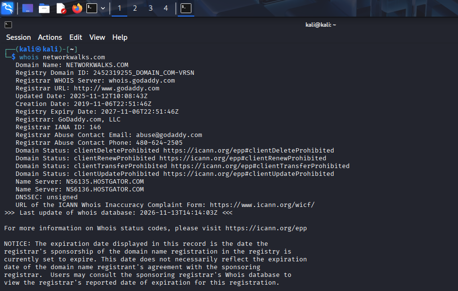
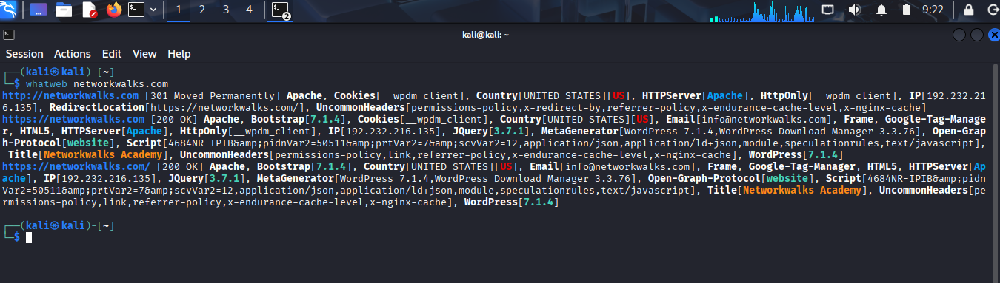
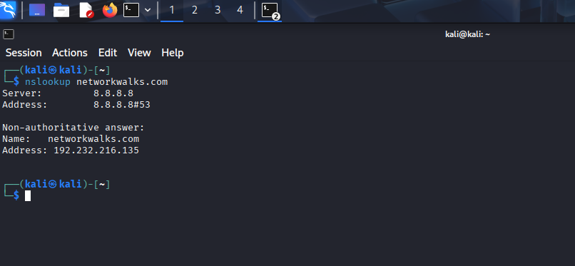
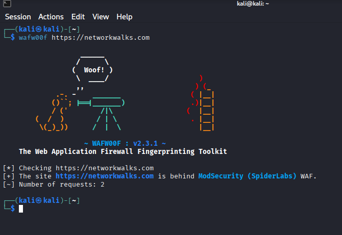
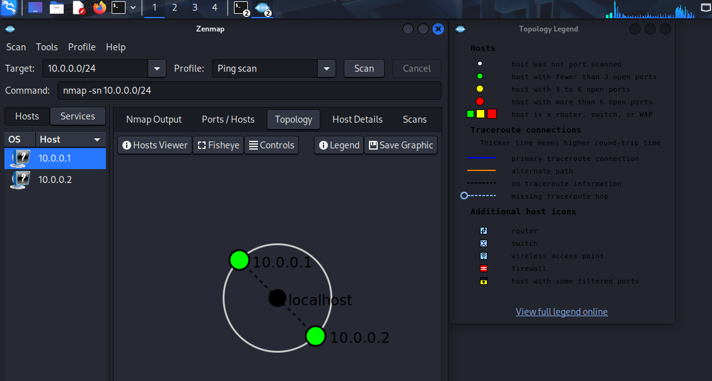

# NETWORKWALKS-ABUUBAKAR-B084-WK2-PM1-5-CYBERSECURITY-FOOTPRINTING-NETWORK-SCANNING
PENETRATION TESTING REPORT FOOTPRINTING &amp; NETWORK SCANNING PHASES

# 🛡️ PENETRATION TESTING REPORT
## FOOTPRINTING & NETWORK SCANNING PHASES

**W2-PM-FINAL | CYBERSECURITY | NETWORKWALKS & LOCAL LAB**

---

## 📋 1. ASSESSMENT INFORMATION

| Field | Details |
|---|---|
| **Pentester Name** | Abuubakar Ramadhan Pandu |
| **Program/Batch** | Cybersecurity |
| **Date** | 13 November 2026 |
| **Modules Completed** | W2-PM1 (Multiple Kali Tools)<br>W2-PM5 (Zenmap Network Scanning) |
| **Client/Target** | 1. `networkwalks.com` (Secured Written Permission)<br>2. Own Local LAN Network (`10.0.0.0/24`) |
| **Permission Secured from Client?** | Yes |
| **Phases Covered** | Phase 1: Reconnaissance & Footprinting<br>Phase 2: Scanning & Network Discovery |

---

## ⚖️ 2. LIABILITY DISCLAIMER

I have performed these activities only on systems and devices where I secured written permission or on devices and systems that I personally own.

All materials presented in this report are intended strictly for **educational and research purposes only**.

Do not use any knowledge or techniques demonstrated in this project to break the law or access systems without authorization.

The instructor, authors, and associated platforms are not responsible for any misuse of the information provided. Every action taken using this knowledge is the sole responsibility of the individual performing it.

Unauthorized access to computer systems is a criminal offense in many countries, even when no damage is caused. Misuse may result in criminal charges, heavy fines, loss of employment, and a permanent criminal record.

**Always ensure that penetration testing activities are performed within an authorized scope.**

---

## 🎯 3. INTRODUCTION

This comprehensive report covers two practical cybersecurity assessment activities:

- **Phase 1 – External Footprinting & Reconnaissance (W2-PM1):** Passive and active information gathering against the `networkwalks.com` domain using multiple Kali Linux utilities.
- **Phase 2 – Internal Network Scanning & Discovery (W2-PM5):** Network discovery and scanning performed on my own local subnet using Zenmap (Nmap GUI).

These combined activities demonstrate how a cybersecurity professional progresses from gathering publicly available intelligence about an external target to identifying live hosts and mapping hardware addresses within an internal network topology.

The assessment focuses on understanding network exposure, identifying visible infrastructure information, analyzing potential security risks, and documenting appropriate recommendations.

---

## 🧰 4. TOOLS & TECHNOLOGIES USED

The following tools and utilities were used throughout the assessment:

| Tool | Purpose |
|---|---|
| 🐉 **Kali Linux** | Operating system used for reconnaissance and network scanning activities. |
| **WHOIS** | Retrieves domain registration details, ownership information, registration dates, and name servers. |
| **WhatWeb** | Fingerprints web technologies, CMS platforms, server information, and plugins. |
| **Nslookup** | Resolves domain names into corresponding IP addresses using DNS. |
| **cURL (`-I`)** | Retrieves and examines HTTP response headers. |
| **Wafw00f** | Detects whether a Web Application Firewall (WAF) protects the website. |
| **DNSRecon** | Enumerates DNS records, including NS, MX, SPF, TXT, and SRV records. |
| **Zenmap** | Graphical interface for Nmap network discovery and scanning. |
| **Terminal Utilities (`ip a`)** | Identifies local network interfaces, IP addresses, and subnet configuration. |

---

## 🔍 5. ACTIVITIES PERFORMED

### 🌐 5.1 PHASE 1: FOOTPRINTING & RECONNAISSANCE

**Target Domain:** `networkwalks.com`

During this phase, I performed external reconnaissance using six primary Kali Linux tools to collect publicly available information about the target domain and its web infrastructure.

#### 🔹 1. WHOIS – Domain Information Gathering

- Retrieved publicly available domain registration details.
- Identified the domain's designated name servers.
- Examined domain registration information and hosting-related details.

**Objective:** Understand the domain's registration and infrastructure information.

#### 🔹 2. WhatWeb – Web Technology Fingerprinting

- Identified technologies used by the target website.
- Detected WordPress as the Content Management System (CMS).
- Identified specific plugin and technology version information.

**Objective:** Understand the technologies and components powering the web application.

#### 🔹 3. Nslookup – DNS Resolution

- Resolved the target domain into its corresponding IP address.
- Examined DNS resolution information.

**Objective:** Identify the IP address associated with the target domain.

#### 🔹 4. cURL (`-I`) – HTTP Header Analysis

- Retrieved HTTP response headers.
- Examined server-related information.
- Observed technical details exposed through HTTP responses.

**Objective:** Understand what technical information the web server reveals through its HTTP headers.

#### 🔹 5. Wafw00f – Web Application Firewall Detection

- Evaluated whether the target website was protected by a Web Application Firewall.
- Examined available firewall identification information.
- Assessed the visibility of the website's security perimeter.

**Objective:** Identify the presence of WAF protection mechanisms.

#### 🔹 6. DNSRecon – DNS Enumeration

- Enumerated available DNS records.
- Examined NS, MX, TXT, SPF, and other relevant records.
- Collected information about the target's DNS infrastructure.

**Objective:** Develop a broader understanding of the target domain's DNS configuration.

---

### 🖥️ 5.2 PHASE 2: NETWORK SCANNING & DISCOVERY

**Target Network:** `10.0.0.0/24`

For the second activity, I shifted from external reconnaissance to internal network discovery using **Zenmap (Nmap GUI)** on Kali Linux.

#### 🔹 1. Subnet Identification

Used the following terminal command to inspect the local network interface configuration:

```bash
ip a
```

This helped identify the local IP address, network interface, and subnet information.

Identified Target Subnet:

```text
10.0.0.0/24
```

### 2. Ping Sweep – Host Discovery

Configured Zenmap to perform a Ping Scan against the local subnet.

**Nmap Command:**
```bash
nmap -sn 10.0.0.0/24
```
### 3. Host Discovery & MAC Address Identification

Successfully identified responsive hosts within the local network. The discovery process provided information such as:
- Active host IP addresses
- MAC addresses of discovered devices
- Network device visibility
- Potential routers and connected local machines

**Objective:** Build an inventory of visible devices within the local network.

---

### 4. Network Topology Mapping

Used the Topology tab in Zenmap to visualize the discovered network environment. Activities included:
- Accessing the Topology visualization
- Enabling the map legend
- Examining the visual representation of discovered hosts
- Reviewing the network connectivity graph

**Objective:** Understand the discovered network structure through graphical visualization.

---

## 6. Risk Analysis & Potential Impact

Based on the observations collected during both assessment phases, the following potential security risks were documented:

| # | Risk / Finding | Evidence / Observation | Potential Impact | Risk Level |
|---|---|---|---|---|
| 1 | Web Technology Version Exposure | WhatWeb identified WordPress and plugin versions. | Attackers may correlate exposed versions with known software vulnerabilities. | 🟡 Medium |
| 2 | Target Server IP Disclosure | Nslookup resolved the domain IP address. | Provides infrastructure information useful during reconnaissance. | 🟢 Low |
| 3 | HTTP Technical Header Disclosure | cURL retrieved detailed HTTP response headers. | Helps attackers fingerprint the server and technologies. | 🟢 Low |
| 4 | WAF Architecture Visibility | Wafw00f identified firewall protection mechanisms. | Provides information about the website's defensive architecture. | 🟢 Low |
| 5 | DNS Records Exposure | DNSRecon enumerated mail and name server records. | Helps construct a broader infrastructure profile. | 🟡 Medium |
| 6 | Active Local Host Visibility | Zenmap identified active internal hosts and MAC addresses. | Unknown or unauthorized devices may become discoverable within the network. | 🟡 Medium |

### Risk Level Classification

| Indicator | Risk Level | Description |
| :---: | :--- | :--- |
| 🔴 | **Critical** | Severe security exposure requiring immediate attention. |
| 🟠 | **High** | Significant risk requiring prompt remediation. |
| 🟡 | **Medium** | Potential security weakness requiring investigation and mitigation. |
| 🟢 | **Low** | Limited exposure with relatively low potential impact. |

> **Note:** These are preliminary qualitative risk ratings based on reconnaissance observations. They do not establish that an exploitable vulnerability exists. Further authorized validation would be required.

---

## 7. Security Recommendations

Based on the observations, the following security improvements are recommended:

### 1. Minimize Information Exposure
- Review publicly exposed server headers.
- Avoid unnecessarily disclosing software version information.
- Review DNS records to ensure that only necessary information is publicly available.

### 2. Keep Software Updated
- Regularly update CMS platforms such as WordPress.
- Patch outdated plugins and extensions.
- Monitor security advisories for known vulnerabilities.

### 3. Configure Web Application Firewalls
- Ensure WAF rulesets are properly configured.
- Review firewall logs regularly.
- Implement appropriate protection against malicious requests and enumeration attempts.

### 4. Implement Network Segmentation
- Use VLANs to separate different network environments.
- Apply firewall rules between network segments.
- Isolate critical systems from general-purpose devices.

### 5. Enforce Network Access Control
- Implement switch-level port security.
- Consider IEEE 802.1X authentication.
- Monitor and restrict unauthorized network connections.

### 6. Perform Periodic Security Audits
- Conduct regular authorized network scans.
- Maintain an updated inventory of connected devices.
- Review external infrastructure exposure.
- Continuously monitor and improve security configurations.

---

## 8. Conclusion

This practical cybersecurity project successfully integrated two important stages of penetration testing: External Footprinting & Reconnaissance and Internal Network Scanning & Discovery.

---

🔍 **EVIDENCE**

---

## 1. Domain Registration & Ownership Analysis

Public domain registration databases are queried to establish administrative ownership, registrar details, and name server delegation.

**Command Executed:**
```bash
whois networkwalks.com
```

**Key Findings & Observations:**

- **Registrar:** GoDaddy.com, LLC
- **Registration Timeline:** Created on 2019-11-06 and set to expire on 2027-11-06
- **Delegated Name Servers:** NS6135.HOSTGATOR.COM and NS6136.HOSTGATOR.COM
- **Domain Status:** Protected with `clientDeleteProhibited`, `clientRenewProhibited`, `clientTransferProhibited`, and `clientUpdateProhibited` flags
- **DNSSEC Status:** Unsigned

**Operational Conclusion:**

This intelligence confirms domain ownership boundaries, identifies HostGator as the underlying DNS hosting provider, and establishes administrative contact vectors.



---

## 2. Web Technology & Application Fingerprinting

Web fingerprinting is performed to identify the underlying server stack, content management systems, plugins, and client-side frameworks deployed on the target.

**Command Executed:**
```bash
whatweb networkwalks.com
```

**Key Findings & Observations:**

- **Web Server:** Apache
- **Content Management System (CMS):** WordPress 7.1.4
- **Detected Plugins:** WordPress Download Manager 3.3.76
- **Frontend Frameworks:** Bootstrap 7.1.4 and jQuery 3.7.1
- **Hosting Location & IP:** 192.232.216.135 (United States)
- **Exposed Contact Vector:** info@networkwalks.com

**Operational Conclusion:**

Exposing exact software and plugin versions enables precise cross-referencing against public vulnerability databases (CVEs) to identify known security flaws.



---

## 3. Infrastructure Resolution & IP Mapping

Domain Name System (DNS) resolution is executed to translate the human-readable domain name into its numeric network-layer IPv4 address.

**Command Executed:**
```bash
nslookup networkwalks.com
```

**Key Findings & Observations:**

- **DNS Resolver Queried:** 8.8.8.8 (Port 53)
- **Resolved IPv4 Address:** 192.232.216.135 (Non-authoritative answer)

**Operational Conclusion:**

Resolving the public IP address allows direct network-level reconnaissance, port scanning, and reverse-IP lookups to identify co-hosted applications on the same server infrastructure.



---

## 4. HTTP Response Header Inspection

HTTP headers are retrieved directly without downloading the full webpage body to inspect server banners, caching layers, security policies, and hidden application endpoints.

**Command Executed:**
```bash
curl -I https://networkwalks.com
```

**Key Findings & Observations:**

- **HTTP Status:** HTTP/1.1 200 OK
- **Server Banner:** Apache
- **Caching Mechanism:** X-nginx-cache: WordPress and X-Endurance-Cache-Level: 0
- **Exposed API Endpoint:** WordPress REST API exposed via Link header (https://networkwalks.com/wp-json/)
- **Cookie Security:** `__wpdm_client` configured with secure and HttpOnly attributes
- **Security Policies:** Permissions-Policy and Referrer-Policy headers active

**Operational Conclusion:**

Response header inspection uncovers backend caching architecture and hidden REST API endpoints (`/wp-json/`), providing structural entry points for further web application testing.


---

## 5. Web Application Firewall (WAF) Detection

Defensive perimeter detection is conducted to determine whether incoming HTTP traffic is monitored or filtered by a Web Application Firewall.

**Command Executed:**
```bash
wafw00f https://networkwalks.com
```

**Key Findings & Observations:**

- **WAF Detection Result:** Positive (ModSecurity (SpiderLabs))
- **Probes Sent:** 2 requests

**Operational Conclusion:**

Confirming the presence of ModSecurity indicates that automated or noisy payload injections may be logged or blocked. Further testing should follow the authorized testing scope and avoid unnecessary traffic.



---

## 6. Comprehensive DNS Enumeration

Full DNS enumeration is performed to map mail exchangers, name server software versions, security policies, and service autodiscovery records.

**Command Executed:**
```bash
dnsrecon -d networkwalks.com
```

**Key Findings & Observations:**

- **SOA & NS Records:** ns6135.hostgator.com (50.87.144.87) and ns6136.hostgator.com (192.232.216.131)
- **DNS Server Version Exposed:** BIND 9.16.23-RH
- **Mail Exchanger (MX):** mail.networkwalks.com (192.232.216.135)
- **TXT & SPF Records:** Google site verification token and SPF policy (`v=spf1 +a +mx +ip4:50.87.144.87 +include:websitewelcome.com ~all`)
- **Service Records (SRV):** 8 cPanel autodiscovery records (`_autodiscover._tcp.networkwalks.com` pointing to `cpanelemaildiscovery.cpanel.net` on port 443)

**Operational Conclusion:**

Comprehensive DNS mapping exposes mail server routing, cPanel hosting dependencies, SPF email spoofing protections, and exact DNS daemon versions (BIND 9.16.23-RH), completing the external infrastructure profile.


---


#  Nmap & Zenmap Network Scanning (Kali Linux)

## Summary Evidence Overview
---

This lab focused on using Nmap and Zenmap on Kali Linux to perform local network discovery and visualize network connectivity.

---

### Task 1: Download & Install Zenmap

Successfully downloaded and installed Zenmap and Nmap from the official Kali Linux repositories using package management tools.

---

### Task 2: Find Local IP Address & LAN Subnet

Used the `ip a` command to identify the local network interface, IP address, and subnet mask.

- **Local IP Address:** `10.0.0.__`
- **LAN Subnet:** `10.0.0.0/__`

---
### Task 3: Find the List of Live Hosts / PCs in the IP Subnet

Launched Zenmap, entered the discovered LAN subnet, and selected the Ping Scan profile to identify active devices on the network.
---
### Task 4: How Many Hosts Are Live in Your Subnet?

Analyzed the Nmap scan summary to determine the total number of responsive hosts, including the local scanning machine.

- **Total Live Hosts:** `___`
---
### Task 5: What Are the IP Addresses of the Live Hosts?

Identified the IP addresses assigned to the active devices discovered during the scan.

- **Host 1:** `10.0.0.__`
- **Host 2:** `10.0.0.__`
---
### Task 6: What Are the MAC Addresses of the Live Hosts?

Identified the MAC addresses associated with the discovered network interfaces.

- **Host 1 MAC:** `__:__:__:__:__:__`
- **Host 2 (Local PC) MAC:** `__:__:__:__:__:__`
---
### Task 7: Display & Save the Output Topology in PDF Format

Opened the Topology tab in Zenmap, reviewed the Topology Legend, and saved the graphical network layout in PDF format.
---
### Final Evidence

The screenshot below provides a visual overview of the Nmap and Zenmap network scanning results, demonstrating the successful completion of the lab tasks.


---

---

## 👨‍💻  Author

**Abuubakar Ramadhan Pandu**
- **🎓 Field:** Digital Forensic Engineering
- **🔐 Interest:** Cybersecurity | Network Security | Penetration Testing
- **🏫 Program:** NetworkWalks Cybersecurity Training
- **📌 Project:** `W2-PM-FINAL` – Footprinting & Network Scanning
- **📅 Date:** 13 November 2026

---
